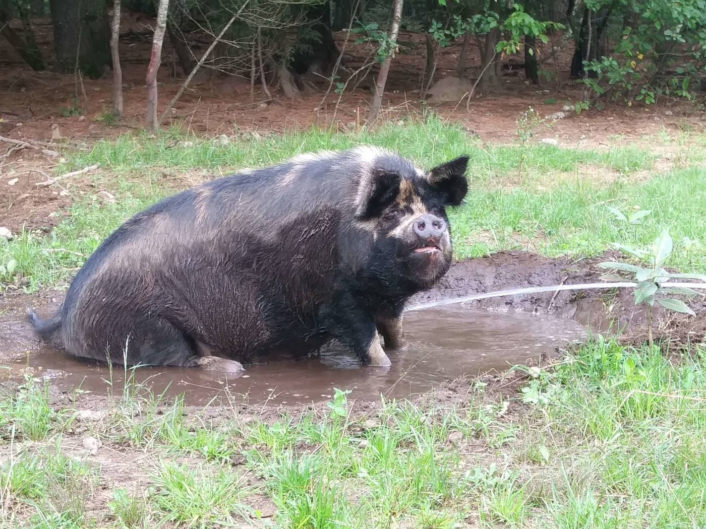
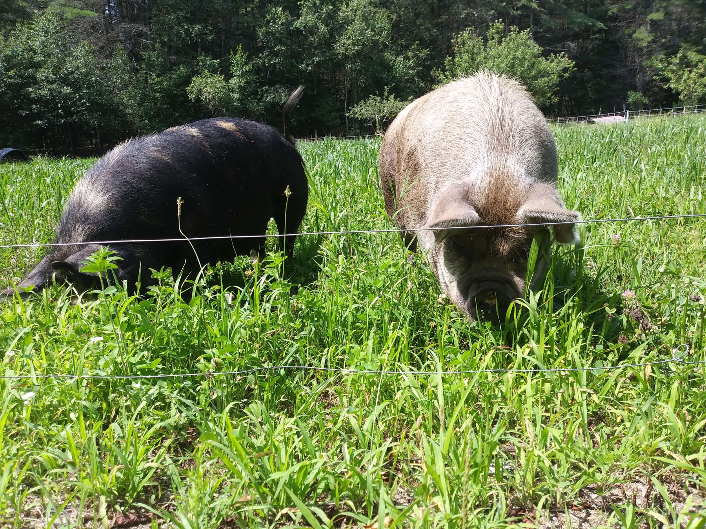

Idaho Pasture Pigs have a shorter, upturned snout, so they actually graze on grass instead of rooting up the pasture. That's better for farms like ours that depend on their pastures, it saves on grain because the pigs fill out their diet with grass and hay, and it makes for healthier (higher in omega-3s), tastier, more marbled meat.

They're docile, excellent mothers with vigorous, well-growing piglets. Boars mature at 300–400 lb and sows at 250–300 lb, so a breeding pair eats far less over a year than the larger traditional breeds. Feeders reach market weight (200–250 lb) at 8 to 10 months.

Here's how we keep ours.

## Wallows

All pigs must have a wallow in warm weather. It's the only way for them to stay cool: pigs don't sweat, so a wallow is a necessity for their comfort and wellbeing.

*We make our wallows at the edge of the forest, within reach of a hose, where grass isn't growing anyway.*

When pigs are on pasture, they will either make their own wallow as needed (which might not be where you want it!) or you can make one for them on the edge of the pasture, preferably where rainwater collects or in a spot where you can add water now and then. That way you're not wasting good grazing. If you can, put it in the shade.

> **Tip:** The younger, smaller piggies won't say no to a kiddie pool in hot weather!

## Rotational grazing

Moving the pigs around to fresh pasture is the best way to use the nutrients, keep your pastures from being overgrazed, and help control parasites.

If your farm only has a small amount of pasture, or you're raising pigs in a drought year, we've found the best way to keep pastures from being overgrazed is to fence the pigs' main living area in the woods, with gates that open onto the grassy areas when there's enough grass.

Ideally pigs get to graze every day, but that depends on the size and quality of the pasture, and whether you need to keep them off it so the grass can bounce back. When that happens, add some hay to their daily ration. They'll readily eat it in place of the grass.

> **Rule of thumb:** Pasture varies, so it's hard to say how much area pigs need. The accepted standard is that the grass that keeps one cow will feed about 10 IPPs. With one acre per cow, that's about one acre for 10 IPPs.

## Fencing

Most of our pigs are kept with one or two low strands of electric metal or poly wire. It's easy to move around and an inexpensive way to fence in large areas.

*One or two low strands of electric wire is all our grown pigs need.*

Younger piglets have to be trained to respect it. We start them on livestock fencing with an electric strand inside it, or on electric pig netting. Both give a physical barrier, which teaches the pig to jump backwards when it gets zapped instead of charging through, as it might with just strands of wire.

## Housing

In summer, pigs do well in A-frame houses, hoop houses made from cattle or hog panels, calf hutches, or any shelter that protects them from sun and bad weather. Open on both ends is best, for air flow in the heat. We stuff the houses with hay for comfort and to keep them dry when it rains.

Similar housing works in winter, as long as it's at least three-sided, and barn stalls work well too. In winter we make sure the houses are filled really well with dry hay to keep the piggies warm. We check the bedding regularly to be sure it's still dry and add more as needed.

> **Tip:** We hang an old piece of carpet in the doorway. The pigs push through it to come and go as they please, and it keeps out the cold and wind.

## Feeding

On top of grazing in summer, or a hay supplement in winter (about 1–2 flakes per pig per day), our adult breeding stock get grain twice a day:

| Season | Grain per day | Split |
|---|---|---|
| Summer | 2–3 lb | 1–1.5 lb morning and evening |
| Winter | 3–4 lb | half morning, half evening |

Ours get Green Mountain Organic for feeder piglets and Poulin Pig Grower for breeding stock. As a supplement, we top-dress the feed with organic kelp, 1 tablespoon per 100 lb of body weight. And piggies never say no to fresh veggies, raw milk, boiled eggs, or drop apples!

The feeder piglets we raise for meat get a diet that steps up as they grow, always with grass or hay available:

| Age | Feed per pig per day |
|---|---|
| Birth to weaning (5–6 weeks) | Free-choice pellets |
| Weaning to 2 months | About 1 lb |
| 2 to 4 months | 2 lb |
| 4 to 6 months | 3 lb |
| 6 to 7 months | 3.5 lb |
| 7 months to processing (about 8 months) | 4 lb |

We always split it into two feedings, half in the morning and half in the evening.

### Water

And let's not forget the most important part of a pig's diet (or anyone's, for that matter): water. They need access to it at all times.

There are many different options for watering systems (just google it and you'll find many!). We use rubber tubs and have good luck with them, although sometimes we need to secure them so they don't get tipped over, or set them inside heavy wooden boxes the pigs can't flip. We haven't had good luck with de-icers, so on winter days we fill the tubs at least three times a day to be sure the pigs always have water, even in freezing temperatures.
